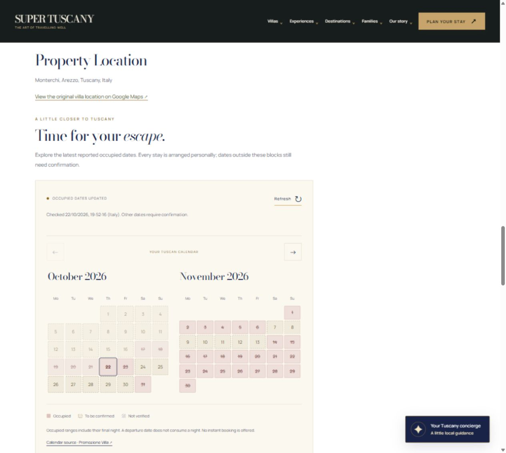

# Read-only villa availability

Branch: `codex/promozionevilla-readonly-availability`. Source audit: 22 October 2026. This change has not been deployed. No hosting settings, GitHub Actions, payments, confirmed reservations or reverse synchronization are introduced.



## What the dates mean

The public endpoint name is misleading: `availabilities` contains **blocked calendar dates**, not an allowlist of available stays. The supplier's JavaScript assigns the response's `availabilities` array to the calendar's `disabled-dates` property. Comparison against the independently rendered public WP Booking System overview confirms that both `start` and `end` are included in the blocked range. Dates are US `MM/DD/YYYY`, interpreted as civil dates without host timezone conversion.

For example, De’ Michelangioli is blocked on 26–28 October 2026 and the overview marks 29 October green. Volterra is blocked on 24–28 October and the overview marks 29 October green. The normalized internal intervals are `[start, dayAfterEnd)`. A requested stay is `[arrival, departure)`: departure itself consumes no night. The API does not supply arrival/departure times, minimum stay rules or permission to check in/out on a turnover day; these still require the team's confirmation. Blank `status`, `CONFIRMED` and either `sequence` value do not make any dates available.

The audit compared **620 public day cells**: October 2026 and July 2027 for all ten villas. Earlier October dates are sometimes omitted from the API although still blocked in the overview. Do not use this feed to reconstruct historical occupancy. Evidence and API responses are in `tests/fixtures/availability-source.json`. The optional `python scripts/verify-availability-source.py` repeats the public read-only comparison; its POST to `admin-ajax.php` is the same non-mutating month-navigation action used by the public calendar. It is never invoked by build, tests or a scheduler. If the supplier changes its client or markup, re-audit before updating the evidence.

## Coverage and villa status

All ten endpoints returned a nonempty, correctly identified villa and valid date ranges during the audit. Nine agree with the public overview for current/future dates in the two sampled months. **Casciano disagrees**: the API blocks 22–23 and 26–31 October while the public overview marks them green. The demo retains those API blocks conservatively and shows a persistent source warning. That warning is dated to this audit and requires a new comparison before removal; runtime polling alone cannot establish that the disagreement is resolved.

| Villa | API ID | Implemented status |
|---|---:|---|
| Palazzo Rosadi | 1081 | Occupied-date feed connected; sampled calendar agrees |
| Villa Casciano | 5054 | Feed connected with explicit source-disagreement warning |
| Villa De’ Michelangioli | 336 | Occupied-date feed connected; sampled calendar agrees |
| Villa dell’Angelo | 1811 | Occupied-date feed connected; sampled calendar agrees |
| Villa Ginestra | 5359 | Occupied-date feed connected; sampled calendar agrees |
| Villa Girasole | 5358 | Occupied-date feed connected; sampled calendar agrees |
| Villa Guardistallo | 5158 | Occupied-date feed connected; sampled calendar agrees |
| Villa Roncovisi | 1813 | Occupied-date feed connected; sampled calendar agrees |
| Villa Torre del Cielo | 1335 | Occupied-date feed connected; sampled calendar agrees |
| Villa Volterra | 6630 | Occupied-date feed connected; sampled calendar agrees |
| Villa Sant’Andrea | — | No mapping, no provider request, all dates unverified |

**None of these feeds establishes positive bookability.** The supplier declares no coverage horizon, completeness guarantee, update timestamp or freshness SLA. A date outside its blocks is labelled “To be confirmed”, never “Available”. Empty arrays, mismatched villa identity, malformed dates, source errors or expired data produce “Not verified”, never an empty calendar presented as free. The comparison is a sample, not proof that every future day matches the other public calendar.

## Runtime design

- `netlify/functions/availability.mjs` is an ordinary on-request serverless GET handler using the existing host's default function directory. No Netlify CLI, API, account connection, scheduled function or configuration change is needed to review/test locally. The function is inactive on the hosted demo until this code is deliberately deployed in a later step.
- `server/availability-service.mjs` uses a fixed allowlist of ten IDs and a fixed upstream origin. Client-supplied URLs and arbitrary IDs are never fetched. Sant’Andrea and unknown villas return HTTP 404 with `unverified`.
- Successful data is cached **120 seconds per warm function instance**, with concurrent request coalescing. Empty/error responses are cached for 15 seconds. The cache is deliberately not persistent or shared: cold instances may refetch independently. No background traffic occurs without a page/request.
- Upstream requests have a six-second abort deadline, reject redirects, require JSON, and cap payloads at 512 KB. Any bad interval invalidates the whole response. Source HTTP errors return local HTTP 503 with no stale intervals.
- After cache expiry, ETag and Last-Modified validators are sent if the supplier supplied them. A content hash detects interval changes even without validators; `checkedAt`, `expiresAt`, `changedAt` and `version` expose freshness separately from change detection. These are observations by our service, not a supplier-provided last-update guarantee.
- Browser/CDN responses use `no-store`; upstream freshness is controlled by the service cache. The browser expires its view at `expiresAt`, refreshes while visible, rechecks on return/online, and offers manual refresh. Manual refresh respects the shared two-minute upstream TTL. Polling is demand-driven, not a cron job.
- Every villa gets an accessible, responsive calendar with text status, table captions, day labels, legend and keyboard-operable month buttons. Dates are informational, not instant-booking buttons. Original calendar embeds remain available under a clearly labelled reference disclosure and are not treated as verified sources.
- The existing stay-request form rechecks through the local server endpoint before submission. Reported occupied nights fail client validation. Other dates may be submitted **only as an explicitly unverified manual enquiry**, including during a source outage; the server never returns “available” or confirms a booking. This browser guard protects the normal enquiry UI, not a booking/payment backend, and direct form submissions are still manual requests requiring staff review. General enquiries, search, galleries, original media and concierge remain intact.

## Verify locally, without contacting Netlify

Node 20+ is sufficient; there are no new npm dependencies.

```sh
npm run build
npm test
npm run dev
```

Open `http://127.0.0.1:4173/properties/palazzo-rosadi`. `scripts/serve.mjs` invokes the same function handler locally. The static build alone cannot serve the API. No Netlify tooling is involved. If your Windows network uses a trusted system certificate authority that Node does not pick up by default, start a current Node version with `NODE_USE_SYSTEM_CA=1`; do not disable certificate validation.

To exercise all ten real provider feeds through the running **local** handler:

```sh
node scripts/check-availability-live.mjs http://127.0.0.1:4173
```

This script refuses non-loopback hosts. It does not submit forms or run at build time.

Browser scenarios verified during implementation:

1. Palazzo Rosadi displays October/November occupied dates; the arrows change month and the narrow layout stacks months.
2. A stay arriving 23 October 2026 and departing 24 October fails validation because the night of the 23rd is blocked.
3. Arrival 24 October and departure 25 October stays explicitly unverified. Submitting in local preview reports “Nothing has been sent”.
4. Sant’Andrea shows all dates “Not verified” and no source mapping.
5. Casciano carries the discrepancy warning. Failure/empty/expired responses are covered by deterministic tests, not induced against the provider.

## Validation and existing check failures

Build produces 80 pages. Deterministic Node tests cover date parsing/leap years, inclusive/exclusive boundaries, overlap/adjacency/year changes, identity mismatch, empty/malformed data, unknown/stale data, cache/coalescing/revalidation/change detection, outages/recovery, timeout/size limits, allowlist/GET/range validation, source discrepancy and all eleven page renderings. Browser tests also exercised the unchanged manual enquiry flow without sending data.

`npm run check` currently fails with seven **pre-existing** errors, reproduced on the unmodified `0c91c87` baseline as well as this branch: its showcase counter uses an over-escaped `\\s` regex and reports zero instead of eleven slides; six original homepage images are not exposed in the existing cinematic layout. The change preserves the same 10,206 internal links; no extra broken-link/media errors are introduced. Those unrelated baseline defects are not silently removed or hidden here.

## PR and automation boundaries

The requested review is a **draft PR**, with `[skip ci] [skip netlify]` in both its title and its commit message. No reviewers or Codex review are requested. No workflow files are added, no workflow runs are dispatched, and no Netlify project/API/CLI is used. The repository's workflow listing was checked read-only and contained zero workflows. Hosting configuration is unchanged.

Netlify documents skipping branch builds through commit messages and deploy previews through PR titles: https://docs.netlify.com/deploy/manage-deploys/manage-deploys-overview/. Opening a PR remains a GitHub event and can generate normal GitHub notifications under the account's existing settings; this change does not alter notification preferences or external integrations. Do not mark the draft ready, merge, remove skip markers or deploy until separately requested.
