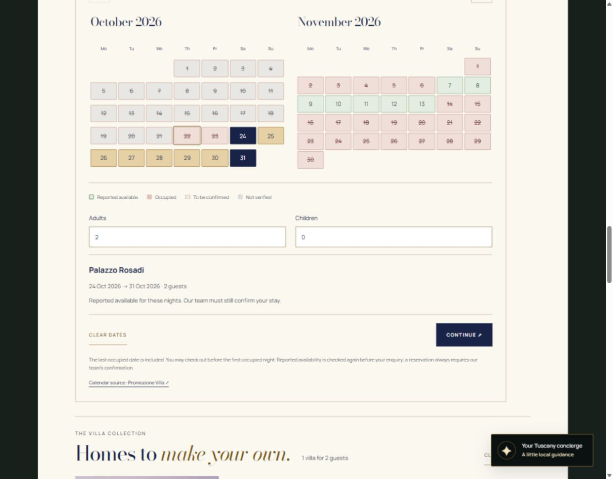
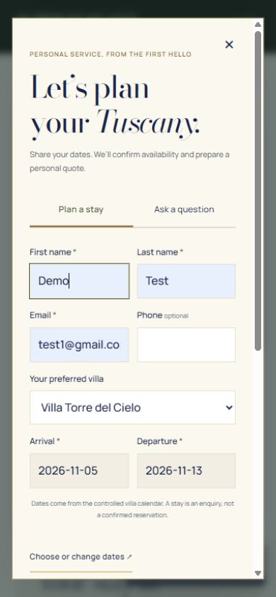

# Shared villa calendars, search and stay enquiries

Branch: `codex/promozionevilla-readonly-availability`. All changes are in the draft PR. No production deployment, hosting configuration change, workflow, payment, confirmed reservation or reverse synchronization is introduced.



## The guest flow

Each villa has the same interactive calendar component used by the reusable search and the date-change dialog. The first click chooses check-in; the second chooses check-out. A completed range is highlighted, retained while changing months, and summarized with the villa and guest count. Continue rechecks the source and opens Plan a stay with villa, dates and guests prefilled.

Arrival and departure in Plan a stay are read-only text fields. “Choose or change dates” opens the controlled picker, preserving the selection and guest count. Changing the villa clears the previous dates before opening its calendar. Guests may still edit their party in the enquiry, subject to the villa capacity. There is no independent native date picker in the stay form. All existing general enquiries, experience search, media, galleries, concierge and legacy calendar reference disclosures remain available.

The reusable finder on the homepage and villa listing now has **Villa → All villas**. With a specific villa, it shows that villa's controlled calendar and locks the search date inputs to its selection. All villas retains general date inputs plus destination, party, bedrooms, bathrooms and amenities. When dates are supplied, only villas whose **every requested night is freshly verified as reported available** are returned. Unknown sources, empty/error feeds, occupied nights, expired data and conflicting months are excluded. Suggestions do not silently reintroduce unverified villas into dated searches. Undated searches still browse the original collection by its existing criteria.

“Reported available” means the provider reports the nights available at the last check. It is **not a confirmed reservation**, a price guarantee, a minimum-stay/rate validation or permission to arrive at any hour. Staff confirmation is always required. A specific-villa calendar may allow a tentative selection marked **To be confirmed** where the occupied-date feed is valid but positive public-calendar evidence is missing/conflicting. That tentative range never qualifies as a verified dated search result. A failed or empty API cannot enable any date selection.

## One availability policy

`public/assets/availability-model.js` is the shared pure policy imported by the server and the browser. `public/assets/availability.js` supplies one shared source cache and one Calendar controller for villa pages, finder and date-change dialog. The general search delegates its availability decisions to this client, and form submission rechecks the same server data/policy. No parallel occupancy logic exists in the search or form.

The model combines:

1. The ten allowlisted Promozione Villa API feeds. Upstream `MM/DD/YYYY` intervals contain **occupied calendar dates with both start and end included**. They normalize to `[start, dayAfterEnd)`.
2. Fresh day-level states from the official public calendar for specifically requested months. `server/public-calendar.mjs` reads the public overview and its non-mutating month-navigation action, validates all ten named rows and every calendar date, and recognizes only the audited green/red legend colours. Changed markup, incomplete dates, unknown colours or a read failure cannot create positive availability.

A stay is `[arrival, departure)`: check-out consumes no night. A stay can depart on the first occupied date if **all prior nights** are usable. It cannot arrive on that occupied date or cross any occupied night. Past dates are rejected using **Europe/Rome civil dates**, including around midnight and timezone changes. Month navigation does not change a chosen date to the same numbered day in another month. Ranges over 366 nights or outside the next three years are not accepted by this demo.

API blocks and official red days take precedence. If a future API block disagrees with an official green day, the affected month's other dates become To be confirmed. This conflict is recomputed at runtime, rather than implemented as a permanent blacklist for one villa. Availability in an unaffected, verified month can be reported independently.

## October and November 2026 audit

`tests/fixtures/availability-oct-nov-2026.json` captures all ten API responses and **610 official day comparisons**: 31 October dates and 30 November dates per villa. It also records the supplier client's use of the response as `v-calendar disabled-dates`. The earlier October/July evidence remains in `availability-source.json` for the original integration tests; it is not a runtime source.

Nine villas agree for current/future days in the October/November sample. **Casciano disagrees on 22–23 and 26–31 October and 1 November:** the API blocks these nights while the public overview is green. Both affected months therefore retain conservative blocks and do not qualify as verified dated search matches. Earlier October API omissions are recorded separately: historical dates may have been pruned and are not selectable regardless of colour.

Concrete boundary checks:

- Palazzo Rosadi: 23 October is occupied; 24–30 October are reported available; 31 October is occupied. **24 → 31 October** is a valid enquiry range; **24 October → 1 November** crosses an occupied night and is rejected.
- De’ Michelangioli: 26–28 October are occupied; 29 October is green in the official overview.
- Volterra: 24–28 October are occupied; 29 October is green.
- Palazzo Rosadi: 1–6 November and 14 November onward are blocked. **7 → 14 November** consumes only unoccupied nights; 14 November can be a departure boundary, not check-in.

| Villa | API ID | Status |
|---|---:|---|
| Palazzo Rosadi | 1081 | Feed and official monthly coverage connected |
| Villa Casciano | 5054 | Connected; October/November conflict detected and restricted |
| Villa De’ Michelangioli | 336 | Feed and official monthly coverage connected |
| Villa dell’Angelo | 1811 | Feed and official monthly coverage connected |
| Villa Ginestra | 5359 | Feed and official monthly coverage connected |
| Villa Girasole | 5358 | Feed and official monthly coverage connected |
| Villa Guardistallo | 5158 | Feed and official monthly coverage connected |
| Villa Roncovisi | 1813 | Feed and official monthly coverage connected |
| Villa Torre del Cielo | 1335 | Feed and official monthly coverage connected |
| Villa Volterra | 6630 | Feed and official monthly coverage connected |
| Villa Sant’Andrea | — | No mapping; never a verified match; dates remain unverified |

The optional `python scripts/verify-availability-source.py` repeats the October/November **read-only** audit. The POST to `admin-ajax.php` uses only `wpbs_refresh_calendar_overview`, the public selector's read action; it does not edit the partner site. This script is not invoked by build, tests or any scheduler.

## Freshness and failure handling

The existing ordinary function `netlify/functions/availability.mjs` remains the only endpoint. It accepts GET, fixed villa slugs, optional validated month lists and optional arrival/departure. Arbitrary upstream URLs or villa IDs are never fetched. Unknown villas, including Sant’Andrea, return unverified/404.

API and public months have **two-minute warm-instance caches**, request coalescing, six-second upstream timeouts and response-size limits. One shared public month response covers all ten villas, reducing repeated reads during general search. Source errors are backed off for 15 seconds. Browser/CDN responses remain `no-store`; stale successes are not returned as fresh. Validators are sent to the API when supplied, and interval hashes detect changes. Public-month freshness is recorded separately, so refreshing an API cannot renew stale calendar coverage.

The browser expires its presentation and dated search matches, rechecks on return/online and offers refresh. It revalidates at Continue and form submission, clears unusable selections, preserves explicit To be confirmed status, and never treats missing evidence as permission to reserve. Polling is demand-driven browser traffic, not an automation or scheduled function. Caches are per instance, not persistent or globally shared; multiple cold instances may refetch.

The partner API has no completeness/freshness SLA or authoritative booking transaction. Public HTML parsing can stop working after a partner markup/legend change. Such a failure degrades to unverified rather than free dates. This is an enquiry demo; the normal browser flow is guarded, but direct form submissions are still manual requests needing staff review, not a server-enforced booking system.

## Contrast, keyboard and mobile

Search, calendars and enquiry dialogs now have explicit light-surface tokens, independent of the dark cinematic homepage. Titles, labels, placeholders, menu search, inputs, options and date states retain readable foregrounds. Live measurements are in `contrast-measurements.json`: search heading **14.41:1**, inputs **15.30:1**, past dates **5.94:1**, occupied dates **7.69:1**, unselected available dates **8.78:1**, secondary summary text **6.76:1**. These are sampled text/surface checks, not a full-site accessibility certification.

Calendar days use labelled native buttons with pressed/disabled state, a roving tab stop, visible focus, arrow/Home/End navigation and PageUp/PageDown month changes. Text labels distinguish availability from occupancy as well as colour. Dialogs use native modal focus containment and Escape. Months stack on narrow screens, with date targets at least 24 CSS pixels and 40-pixel mobile heights.



## Local verification

Node 20+; no added npm dependencies and no Netlify tooling:

```sh
npm run build
npm test
npm run dev
node scripts/check-availability-live.mjs http://127.0.0.1:4173
```

Open `/properties/palazzo-rosadi`, `/`, and `/tuscany-villas-for-rent` on the local server. `scripts/serve.mjs` serves the same function locally. The smoke test refuses remote hosts and checks both displayed months for all ten villas. If a current Windows Node installation needs the trusted system certificate store, use `NODE_USE_SYSTEM_CA=1`; do not disable certificate validation.

Verified browser scenarios: first/second date clicks and seven-night highlight; occupied departure boundary; cross-block rejection; preserved selection across month changes; Continue prefill; read-only form dates and reopening the controlled picker; specific-villa search; All villas returning six verified matches for 24–31 October for two guests; narrow/mobile layout; no console errors. API failure/empty/stale/changed-parser cases are tested deterministically without inducing failures on the partner service. Local form tests use placeholder data and do not send enquiries.

Build: **80 pages**. **24 deterministic tests pass**, covering date and timezone boundaries, selection, coverage, conflicts, empty/error/stale data, cache/recovery/coalescing/timeout/size limits, parser changes, server range policy and all eleven page renderings. The original `npm run check` has seven pre-existing failures reproduced on untouched `0c91c87`: an over-escaped showcase-count regex and six unexposed original homepage images. They are documented rather than hidden; no new missing-link/media errors were introduced.

## Review boundary

The existing PR stays **draft**, with `[skip ci] [skip netlify]` in its title and every new commit. No reviewer/Codex-review request, workflow dispatch, Netlify CLI/API/project access or production deployment is performed. Hosting configuration and main are unchanged. Netlify documents these skip markers at https://docs.netlify.com/deploy/manage-deploys/manage-deploys-overview/. Keep the draft and skip markers until a separate deployment decision.
