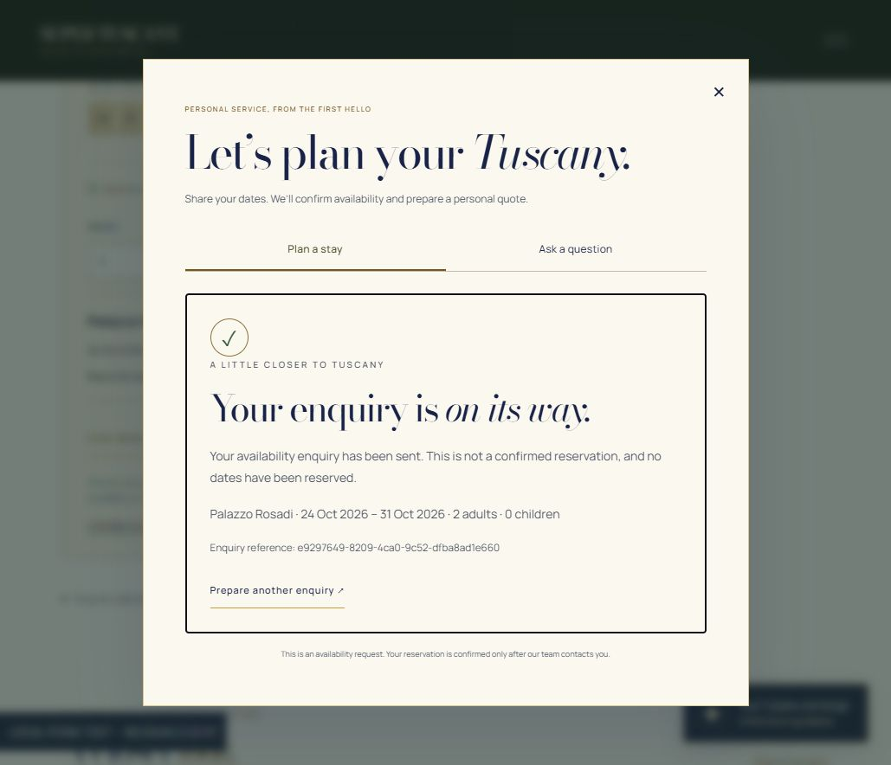
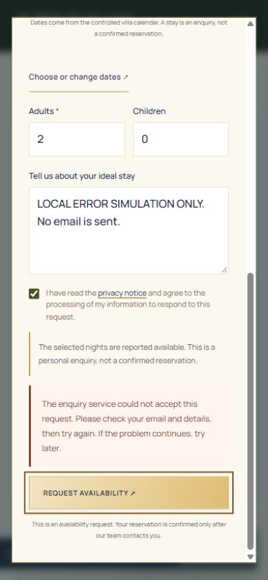

# Availability enquiries with Formspree

The stay enquiry uses `https://formspree.io/f/mojboraw`. Only the availability form is migrated. General information and concierge message forms keep their existing behaviour; no test should submit either of those forms.

The stay form has no `data-netlify`, `netlify-honeypot` or `form-name` field. Its controller prevents native submission and posts JSON to the fixed Formspree endpoint, with no Netlify, email, partner or alternate transport fallback. There is no recipient, CC or forwarding address in the payload. Recipients and any forwarding/plugins remain controlled by the owner's Formspree dashboard and cannot be verified from the public form ID.

## Guest flow

The controlled calendar retains the villa, check-in, check-out and guest counts. The enquiry also includes first/last name, email, optional phone and message, privacy consent, current availability status, source page and an enquiry reference. Arrival/departure remain read-only. The shared availability policy rechecks dates immediately before sending: occupied, past, empty, failed or unusable source responses cannot send. Valid feed dates without verified public coverage remain explicitly “To be confirmed”; they never become confirmed availability or reservations.

The submit button starts disabled until the calendar/submission controller is ready. During checks it prevents another submission; while sending, the details are locked. A changed or closed/reopened form cannot send after an asynchronous availability check. A successful JSON acceptance displays a styled receipt with villa, dates, guests and reference, explicitly stating that no reservation or calendar block was created.

Rejected requests keep the entered details. Network errors, 20-second timeouts, unexpected/empty responses and server errors do not show success and are never retried automatically. An ambiguous response may already have been accepted upstream: the visitor is warned to check delivery before a deliberate retry. Formspree does not provide a transactional booking or an exactly-once delivery guarantee here; the enquiry reference is for tracing, not an unsupported idempotency guarantee.

Identical accepted enquiries are suppressed in the current tab for 30 minutes, including reloads when session storage is available. Storage contains only a SHA-256 fingerprint, expiry and enquiry reference, never raw contact or stay details. If browser storage is unavailable, in-memory duplicate protection still applies to the open page.

## Verification boundary

- `npm run build` and `npm test` run without sending enquiries.
- Automated submission tests inject an in-memory transport and never contact Formspree or Netlify Forms.
- Localhost previews keep the existing no-send behaviour. A separate ignored local test server redirects the Formspree transport to a loopback fixture; browser success/error checks use that fixture, never the real endpoint.
- An OPTIONS preflight from `https://supertuscany.netlify.app` returned HTTP 200 and allowed POST with `content-type`; this does not prove delivery, activation or recipient identity.
- Before any real submission, the owner must confirm that `mojboraw` delivers only to their email, with no forwarding to Christian, `info@supertuscany.org` or partners. Send only one clearly labelled test enquiry after that confirmation.
- The owner confirmed this recipient restriction on 22 October 2026 and authorized publication followed by one labelled real test. No recipient setting is inferred from the public endpoint.
- Published-site verification must check the actual versioned assets, controlled date selection, prefilled fields, absence of Netlify detection attributes and the successful receipt. An actual inbox delivery can only be confirmed by the recipient.

No calendar writes, confirmed bookings, payments, hosting changes, new workflows or schedules are introduced.

Local checks: build generates 80 pages; 34 tests pass. The original site checker retains the same seven pre-existing failures (the villa showcase count regex and six original homepage images); no new broken links/assets were found. Browser checks cover the controlled dates, prefilled contact/stay payload, sending lock, success receipt, rejected request retaining all details and the 390-pixel layout (339-pixel dialog client/scroll width, no horizontal overflow, no console errors).

References: [Formspree AJAX](https://help.formspree.io/articles/building-your-form/submit-forms-with-javascript-ajax/), [honeypot](https://help.formspree.io/articles/building-your-form/honeypot-spam-filtering/), [recipient configuration](https://help.formspree.io/articles/form-and-project-settings/changing-a-form-email-address).
